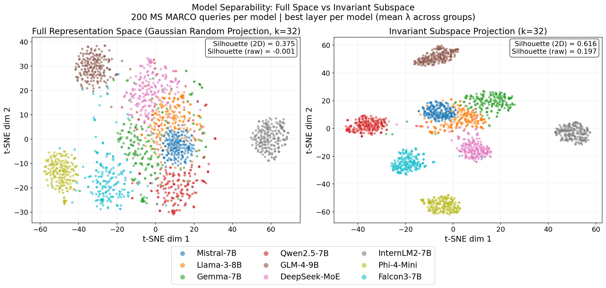

# Invariant Features in Language Models: Geometric Characterization and Model Attribution
---

**Agnibh Dasgupta\***, **Abdullah All Tanvir\***, **Xin Zhong†**  
Department of Computer Science, University of Nebraska Omaha

\* Equal contribution. † Corresponding author.

[🌐 Project page](https://cent664.github.io/LLMID/) · [📄 Paper (arXiv)](https://arxiv.org/abs/2605.06458) · [💻 Code](https://github.com/XinZhong-AI/InvariantFeaturesLanguageModels)

**🔍 Project Overview**
---
We give a local geometric characterization of semantic invariance in language models: paraphrases tend to move along nuisance directions, while meaning lives in a more stable subspace. Contrasting meaning-preserving and meaning-changing edits recovers that subspace. Interventions test it, and its model-specific geometry supports zero-shot model attribution.

**Overview of the proposed scheme:**
---


**📊 Results Snapshot**
---
Projecting representations into the recovered invariant subspace sharpens separation between models (right), compared with the full representation space (left). Invariant-zone signatures also support strong zero-shot attribution, including after fine-tuning and distillation (Ours: 95.45 / 94.20 / 92.25 vs lower PCA and cPCA baselines).


**📚 Citation**
---
```bibtex
@inproceedings{dasgupta2026invariant,
  title     = {Invariant Features in Language Models: Geometric Characterization and Model Attribution},
  author    = {Dasgupta, Agnibh and Tanvir, Abdullah All and Zhong, Xin},
  booktitle = {Advances in Neural Information Processing Systems},
  year      = {2026}
}
```
📌 A. Dasgupta, A. A. Tanvir, and X. Zhong, "Invariant Features in Language Models: Geometric Characterization and Model Attribution," in *Advances in Neural Information Processing Systems (NeurIPS)*, 2026.
