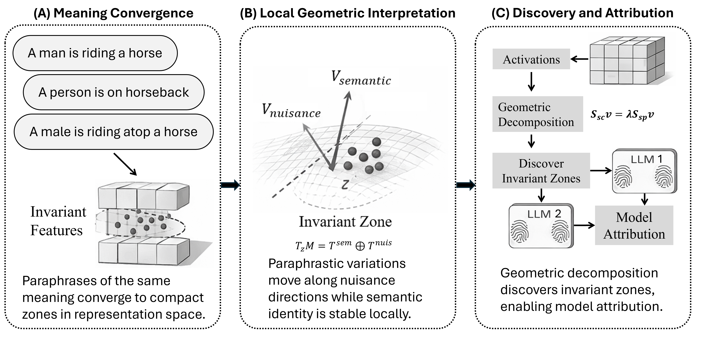
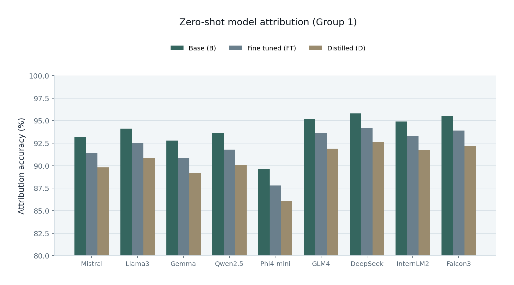

# Invariant Features in Language Models: Geometric Characterization and Model Attribution
---

**Agnibh Dasgupta\***, **Abdullah All Tanvir\***, **Xin Zhong†**  
Department of Computer Science, University of Nebraska Omaha

\* Equal contribution. † Corresponding author.

[🌐 Project page](https://cent664.github.io/LLMID/) · [📄 Paper (arXiv)](https://arxiv.org/abs/2605.06458) · [💻 Code](https://github.com/XinZhong-AI/InvariantFeaturesLanguageModels)

**🔍 Project Overview**
---
We give a local geometric characterization of semantic invariance in language models: paraphrases tend to move along nuisance directions, while meaning lives in a more stable subspace. Contrasting meaning-preserving and meaning-changing edits recovers that subspace. Interventions test it, and its model-specific geometry supports zero-shot model attribution.

**Overview of the proposed scheme:**
---


**🧪 Synthetic Data Set**
---
To isolate meaning-preserving (SP) vs meaning-changing (SC) variation, we construct a synthetic English dataset of short prompts organized into semantic groups. Each group starts from an anchor sentence; SP variants paraphrase the anchor, soft SC variants keep the same topic family but change the intended meaning, and hard SC variants move to a different topic or domain. Groups span multiple domains, with disjoint discovery and validation splits (1,400 groups · 13 domains · 57,400 sentences overall). The table below shows one sample of each type for ten example groups (counts per group in the column headers).

| Group | SP (20) | Soft SC (10) | Hard SC (10) |
| --- | --- | --- | --- |
| 🐈 Cats | Describe the hunting habits of domestic cats. | Describe the sleeping behavior of domestic cats. | Describe the migration of monarch butterflies. |
| 🇫🇷 France | Which language is officially recognized in France? | What is the capital city of France? | What is the longest river in South America? |
| 🐍 Python | What factors led to Python becoming the dominant language in data science? | Why did Python become popular in academia? | What causes ocean tides on Earth? |
| 🌱 Photosynthesis | What are the advantages and disadvantages of engineering crops for improved photosynthesis? | What are the pros and cons of engineering crops for drought resistance? | How does a transistor amplify an electrical signal? |
| 🗳️ Democracy | What role does free speech play in a democratic society? | Describe the role of free press in a democratic society. | How do black holes form from collapsing stars? |
| 🧠 Einstein | Which theory is Albert Einstein best known for? | What is Einstein's nationality? | What is the chemical formula for table salt? |
| 🌡️ Climate Change | What impact does climate change have on global sea levels? | Describe the effect of climate change on Arctic ecosystems. | How does the digestive system break down proteins? |
| ∫ Calculus | How is the derivative of a composite function calculated? | How do you evaluate the limit of a function? | What languages were spoken in the Roman Empire? |
| 🧘 Meditation | What cognitive benefits are associated with regular meditation practice? | Describe the physical benefits of regular meditation practice. | How do jet engines produce thrust? |
| 🍞 Bread | What is the main leavening agent in sourdough bread? | What is the main ingredient in sourdough bread? | What is the boiling point of water at sea level? |

**📊 Results Snapshot**
---
Invariant-zone signatures identify the source model under base, fine-tuned, and distilled variants. The plot below shows Group 1 attribution accuracy (%) from the project page (Figure 7), with strong performance across model families.


**📚 Citation**
---
```bibtex
@article{dasgupta2026invariantArxiv,
  title   = {Invariant Features in Language Models: Geometric Characterization and Model Attribution},
  author  = {Dasgupta, Agnibh and Tanvir, Abdullah All and Zhong, Xin},
  journal = {arXiv preprint arXiv:2605.06458},
  year    = {2026}
}
```
📌 A. Dasgupta, A. A. Tanvir, and X. Zhong, "Invariant Features in Language Models: Geometric Characterization and Model Attribution," arXiv preprint arXiv:2605.06458, 2026.

*Citations will be updated once the final venue details become available.*
